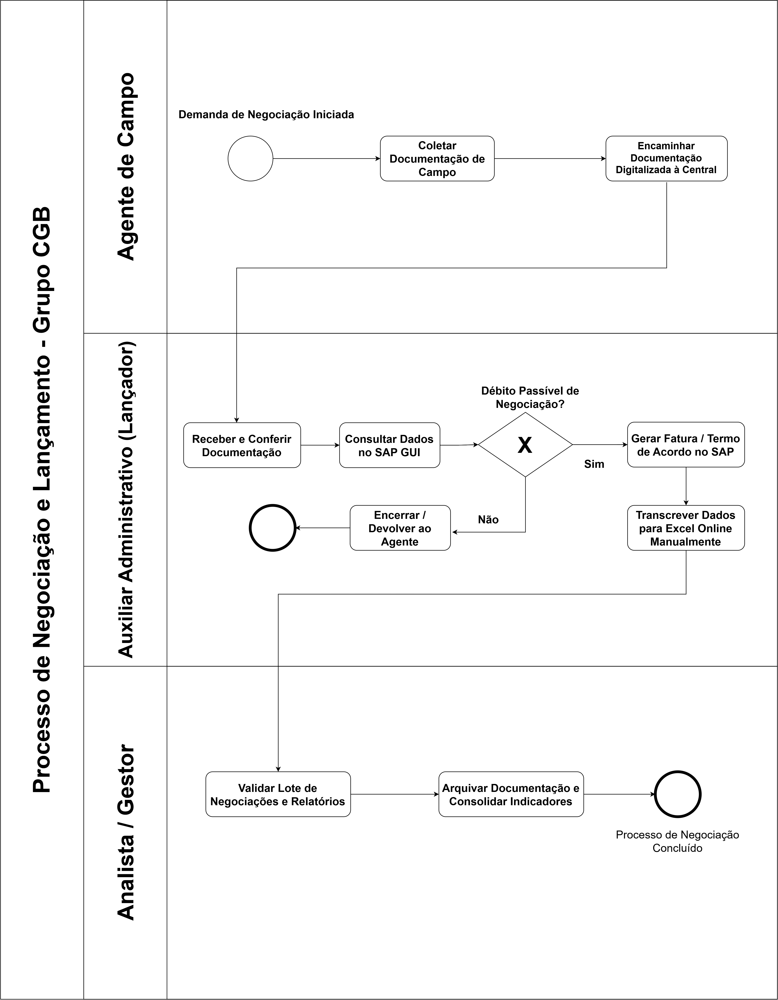
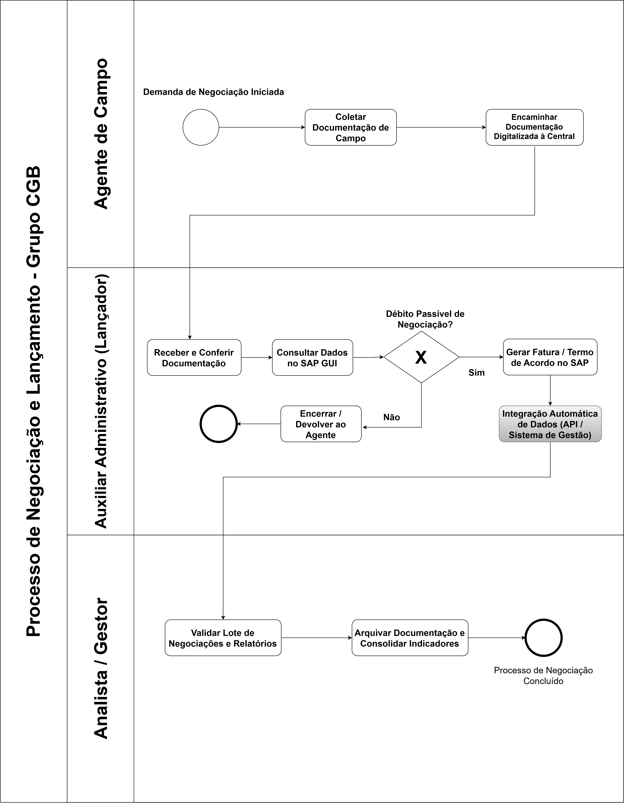
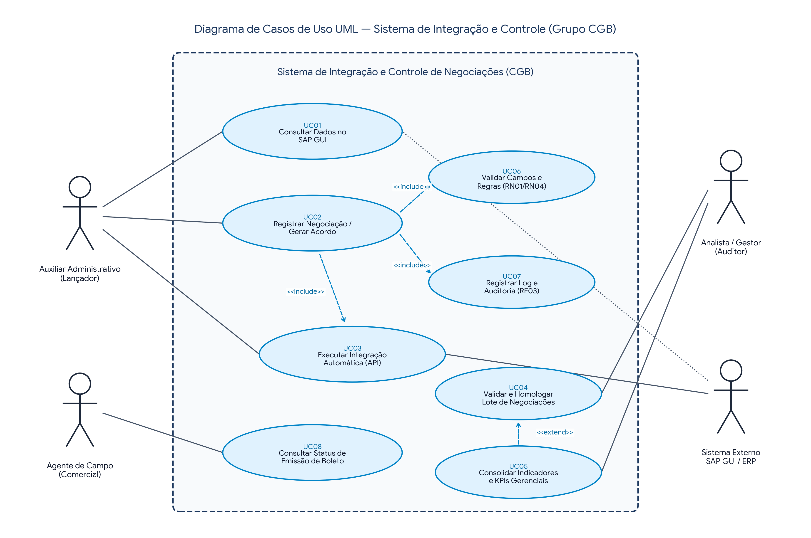

# 03 — Modelagem de Processos (BPMN) e Casos de Uso (UML) (T2)

## Comparativo Estrutural: Processo Atual (AS-IS) vs. Processo Futuro (TO-BE)

A modelagem BPMN organiza a operação do Grupo CGB em uma piscina com três raias organizacionais: **Agente de Campo**, **Auxiliar Administrativo (Lançador)** e **Analista / Gestor**.

| Raia / Etapa | Fluxo Atual (AS-IS) e Gargalo | Fluxo Proposto (TO-BE) e Melhoria |
| :--- | :--- | :--- |
| **1. Agente de Campo** | Coleta documentação física/digital com o cliente e envia à central, sem visibilidade do status posterior. | Mantém coleta e envio padronizado à central, recebendo retorno ágil do boleto gerado após validação síncrona. |
| **2. Auxiliar Administrativo** | Confere documentos, consulta SAP GUI, decide viabilidade, gera fatura/acordo no SAP e transcreve manualmente todos os campos no Excel Online (gargalo crítico). | Após conferir e gerar acordo no SAP GUI, executa a integração/cadastro validado no sistema web, que bloqueia campos vazios e elimina a planilha Excel. |
| **3. Analista / Gestor** | Recebe planilha ao fim do dia/mês, confere linhas manualmente em busca de erros e consolida indicadores tardiamente. | Acessa painel web em tempo real, filtra registros já validados na origem, homologa o lote e exporta indicadores consolidados instantaneamente. |

---

## Casos de Uso UML (Visão Geral)

O sistema contempla os casos de uso principais **UC01 a UC05**, apoiados por casos de uso auxiliares de validação, registro de auditoria e consulta de status (`UC06` a `UC08`):

* **UC01 — Consultar Dados do Cliente e Débitos no SAP GUI:** verifica situação cadastral, instalação e elegibilidade antes do registro.
* **UC02 — Gerar Fatura ou Termo de Acordo e Validar Regras de Negócio:** formaliza condição de pagamento (à vista ou parcelado com entrada) e valida regras/campos obrigatórios.
* **UC03 — Executar Integração Automática e Persistir Negociação:** sincroniza os dados entre SAP GUI e PostgreSQL, vinculando matrícula do operador e timestamp.
* **UC04 — Auditar e Homologar Lote de Negociações:** permite ao analista filtrar pendências, conferir mascaramento de CPF e homologar o lote bloqueando edições indevidas.
* **UC05 — Consolidar Indicadores e Relatórios Gerenciais (KPIs):** gera métricas por modalidade de pagamento, operador e status de homologação.

---

## Especificação Textual dos Casos de Uso

### UC01 — Consultar Dados do Cliente e Débitos no SAP GUI
* **Objetivo:** verificar situação cadastral, status da instalação e elegibilidade de negociação do cliente antes do registro.
* **Atores:** Auxiliar Administrativo (Principal); Sistema SAP GUI (Secundário).
* **Pré-condições:** auxiliar autenticado no ambiente corporativo e documentação de campo recebida do agente.
* **Fluxo Principal:**
  1. Auxiliar informa CPF/CNPJ ou Conta Contrato.
  2. Sistema consulta base cadastral vinculada.
  3. Sistema exibe dados da instalação, histórico de parcelamentos e débitos elegíveis.
  4. Auxiliar confirma elegibilidade para prosseguir com o acordo.
* **Fluxos Alternativos:**
  * **FA01 — Débito não elegível:** caso o cliente possua restrição contratual ou parcelamento ativo bloqueante, o auxiliar encerra a análise e devolve a documentação ao agente de campo.
* **Exceções:**
  * **EX01 — Cliente não localizado:** sistema informa inexistência da Conta Contrato; auxiliar solicita conferência documental ao agente.
* **Pós-condições:** elegibilidade do cliente validada para abertura de nota/fatura de acordo.

### UC02 — Gerar Fatura ou Termo de Acordo e Validar Regras de Negócio
* **Objetivo:** formalizar a condição de pagamento (à vista ou parcelado com entrada) garantindo integridade dos campos obrigatórios.
* **Atores:** Auxiliar Administrativo (Principal).
* **Pré-condições:** cliente elegível validado (`UC01`) e nota de negociação emitida no SAP GUI.
* **Fluxo Principal:**
  1. Auxiliar seleciona a modalidade de pagamento (À Vista ou Parcelado).
  2. Auxiliar preenche valor negociado, nota, conta contrato e contato.
  3. Sistema valida dependências (`RN01`, `RN03`, `RN04`).
  4. Sistema libera o registro para sincronização.
* **Fluxos Alternativos:**
  * **FA01 — Cliente sem telefone:** auxiliar seleciona a opção explícita `"Sem número"` (`RN04`), permitindo prosseguir sem bloqueio.
* **Exceções:**
  * **EX01 — Campo obrigatório ausente (`RF05`):** sistema bloqueia o envio e destaca em vermelho os campos pendentes.
  * **EX02 — Parcelamento sem entrada (`RN01`):** sistema impede gravação até que o valor de entrada e parcelas sejam informados.
* **Pós-condições:** negociação validada conforme regras de negócio e liberada para sincronização (`UC03`).

### UC03 — Executar Integração Automática e Persistir Negociação
* **Objetivo:** sincronizar os dados da negociação entre o SAP GUI e o banco de dados PostgreSQL, eliminando a planilha Excel.
* **Atores:** Auxiliar Administrativo (Iniciador); API Backend / SAP GUI (Sistemas).
* **Pré-condições:** formulário validado sem pendências (`UC02`) e sessão JWT ativa.
* **Fluxo Principal:**
  1. Auxiliar aciona o salvamento/sincronização.
  2. API Backend valida o payload (DTO) e verifica unicidade da Nota.
  3. Sistema grava a negociação no PostgreSQL vinculando matrícula do operador e timestamp (`RF03`).
  4. Sistema registra log de auditoria criptografado (`RNF04`) e confirma operação em até 3s (`RNF01`).
* **Fluxos Alternativos:**
  * **FA01 — Importação via arquivo autorizado:** caso a integração síncrona direta com o SAP esteja em contingência, o auxiliar importa o arquivo estruturado exportado do SAP GUI para validação em lote pela API.
* **Exceções:**
  * **EX01 — Queda de conexão local:** SPA armazena temporariamente o rascunho em fila local (IndexedDB) e alerta o usuário para reenvio automático.
  * **EX02 — Nota duplicada:** API rejeita a gravação com erro HTTP 409 informando registro já existente.
* **Pós-condições:** negociação persistida no banco central com status `"Pendente de Auditoria"` e log registrado.

### UC04 — Auditar e Homologar Lote de Negociações
* **Objetivo:** permitir ao analista revisar a conformidade dos lançamentos e homologar o fechamento do lote.
* **Atores:** Analista Responsável / Gestor (Principal).
* **Pré-condições:** usuário autenticado com perfil `"Analista"` ou `"Gestor"` (`RN02`) e existência de negociações registradas (`UC03`).
* **Fluxo Principal:**
  1. Analista acessa o painel de auditoria e aplica filtros por data, operador ou status (`RF04`).
  2. Sistema exibe lista paginada com CPF parcialmente mascarado (`RES02`).
  3. Analista confere valores, entradas e notas vinculadas.
  4. Analista aciona `"Homologar Lote"` (`homologarLote()`).
  5. Sistema altera status para `"Homologado"`, bloqueia edições retroativas e grava log de auditoria.
* **Fluxos Alternativos:**
  * **FA01 — Devolução para correção:** caso identifique divergência documental, o analista marca o registro como `"Devolvido com Ressalva"`, notificando o auxiliar lançador para retificação.
* **Exceções:**
  * **EX01 — Acesso não autorizado:** tentativa de acesso por usuário com perfil `"Auxiliar"` resulta em bloqueio HTTP 403 e registro de tentativa em log.
* **Pós-condições:** lote homologado oficialmente, imutável para lançadores e disponível para consolidação gerencial.

### UC05 — Consolidar Indicadores e Relatórios Gerenciais (KPIs)
* **Objetivo:** gerar métricas consolidadas de produtividade, volume negociado e tempo de ciclo para a gestão local.
* **Atores:** Analista Responsável / Gestor (Principal).
* **Pré-condições:** existência de lotes homologados ou registros ativos no período consultado.
* **Fluxo Principal:**
  1. Gestor acessa o módulo de indicadores e seleciona o intervalo de datas.
  2. Sistema agrega totais por modalidade de pagamento, operador e status de homologação.
  3. Sistema exibe resumo tabular e permite exportação em CSV/PDF gerencial.
* **Fluxos Alternativos:**
  * **FA01 — Filtro por operador específico:** gestor isola métricas individuais para acompanhamento de metas mensais.
* **Exceções:**
  * **EX01 — Período sem movimentação:** sistema exibe aviso informativo de ausência de registros para o filtro selecionado.
* **Pós-condições:** relatório gerencial exibido/exportado sem alteração na integridade dos dados transacionais.

